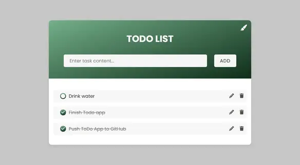

# ToDo App

A simple ToDo list app built with pure HTML, CSS and vanilla JavaScript.

**[Live demo](https://aga1616.github.io/ToDo-App/)**



## Table of Contents

- [Features](#features)
- [Technologies](#technologies)
- [Getting started](#getting-started)
- [What I learned](#what-i-learned)
- [Possible improvements](#possible-improvements)
- [Author](#author)

## Features

- Add tasks with the input field and the **ADD** button or the Enter key (up to 60 characters per task)
- Edit existing tasks in a popup window (Enter to save, Esc to close)
- Mark tasks as completed; completed tasks move to the bottom of the list
- Delete tasks
- Tasks are saved in the browser (`localStorage`), so they are still there after a refresh
- Choose a theme color (pink, orange, blue or green) from the settings panel
- Selected theme is saved in `localStorage` and applied before the page renders, so there is no flash of the default theme
- Responsive layout; on mobile the edit popup stays above the on-screen keyboard
- Accessibility basics: ARIA labels on inputs, buttons and dialogs, a live region for the task list and keyboard support for toggling tasks (Enter / Space)
- Messages for an empty list and for an empty input

## Technologies

- **HTML5**
- **CSS3** (custom properties for theming)
- **JavaScript** (ES6+, no libraries)
- [Font Awesome](https://fontawesome.com/) for icons
- [Google Fonts](https://fonts.google.com/) — Poppins

## Getting started

No installation is needed.

1. Clone the repository:
   ```bash
   git clone https://github.com/aga1616/ToDo-App.git
   ```
2. Open the project folder:
   ```bash
   cd ToDo-App
   ```
3. Open `index.html` in your browser (or use a local server such as the VS Code _Live Server_ extension).

## What I learned

- Manipulating the DOM with vanilla JavaScript
- Handling events and building a popup dialog
- Persisting user preferences with `localStorage`
- Theming with CSS custom properties
- Writing more accessible markup with ARIA attributes

## Possible improvements

- Filtering and sorting tasks
- Due dates and priorities
- Drag-and-drop reordering

## Author

Created by [aga1616](https://github.com/aga1616).
